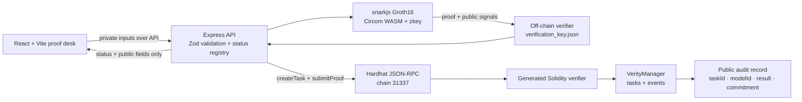

# Verity Finance

Verity Finance is a privacy-preserving financial computation demonstrator. It turns bounded private credit features into a genuine Circom/Groth16 proof, verifies that proof off-chain, and records the public outcome through a Solidity verifier and `VerityManager` audit contract.

The experience is designed for a live hackathon demo: a judge can enter private inputs, watch the proof stages resolve, inspect the public task record, and alter the claimed score to see the original proof fail. The formula is a demonstrator, not a validated lending model.

## Current status

| Area | Status | Evidence |
| --- | --- | --- |
| Credit-score circuit v1 | Implemented and tested | `circuits/credit_score.circom`, witness/proof/tamper commands |
| Real Groth16 proving and off-chain verification | Implemented and tested | `backend/tests/unit/zkRealProof.test.ts`, `npm run verify` |
| Generated Solidity verifier | Implemented and compiled | `contracts/VerityCreditScoreVerifier.sol`, Hardhat compile |
| `VerityManager` task lifecycle | Implemented and tested | 19 Hardhat tests, duplicate and tamper reverts |
| Backend API | Implemented and tested | 82 Vitest tests, real-mode service wiring |
| React frontend | Implemented and production-built | `frontend/`, Vite build and TypeScript check |
| Real API → proof → local chain flow | Verified locally | `npm run e2e:http` with real + real modes |
| Public testnet deployment | Planned | Requires a confirmed RPC, deployer, and human-approved network |
| Production trusted setup / financial model validation | Planned | Outside this hackathon demonstrator |

## Architecture



### Repository map

- `circuits/` — authoritative Circom circuits for credit-score v1 and separate eligibility v2.
- `build/` — committed demo artifacts: WASM, R1CS, proving keys, verification keys, sample proofs, and public signals.
- `contracts/` — generated Groth16 verifiers and `VerityManager`.
- `backend/` — TypeScript Express service, ZK proof service, ethers v6 chain service, schemas, and tests.
- `frontend/` — React/Vite trust-engine experience connected to the backend.
- `lib/` and `scripts/` — proof formatting, artifact helpers, deployment, ABI export, and E2E scripts.
- `deployments/` — reviewable ABI files and local deployment output generated by the deploy command.

## Approved models and public signals

### Credit-score v1 — model ID 1

```text
score = 300 + 3*paymentHistory + 2*incomeStability + debtHeadroom
```

Private circuit values are `paymentHistory`, `incomeStability`, `debtHeadroom` in `[0, 100]`, plus a backend-owned `inputSalt`. The public signal order is exact and positional:

```text
[claimedScore, modelId, taskId, inputCommitment]
```

The Poseidon commitment preimage order is:

```text
[paymentHistory, incomeStability, debtHeadroom, inputSalt, taskId, modelId]
```

The API retains its original input names and maps them inside the trusted backend:

```text
repaymentIndex → paymentHistory
incomeIndex    → incomeStability
historyIndex   → debtHeadroom
```

For the approved example `82, 74, 61`, the circuit score is `755`. A proof of arithmetic correctness does not prove that source financial data is truthful, fair, or suitable for a lending decision.

### Eligibility v2 — model ID 2

The separate circuit proves an eligibility bit against threshold `700` with public signals `[eligible, threshold, modelId, taskId, inputCommitment]`. It shares the arithmetic formula but is not cryptographically linked to a credit-score v1 proof. The frontend keeps eligibility distinct from the score demo.

## Prerequisites

- Node.js 18+ and npm 9+.
- A local Hardhat node for the real chain demo.
- No Circom binary is required for normal use because the compiled demo artifacts are committed. `npm run compile` is available when circuit artifacts need to be rebuilt.

## Install

From the repository root:

```powershell
npm install
pushd backend; npm install; popd
pushd frontend; npm install; popd
copy .env.example .env
```

The root package owns ZK and Hardhat dependencies. `backend/` and `frontend/` intentionally keep separate lockfiles and dependency boundaries.

## Run the frontend and backend

### Fast UI development with mock services

```powershell
# terminal A
pushd backend
npm run dev

# terminal B
pushd frontend
npm run dev
```

Open `http://localhost:5173`. Vite proxies `/api` to `http://localhost:3000`. Mock mode is clearly labeled in the interface and must not be described as cryptographic verification.

### Genuine local proof + chain demo

Start a local chain and deploy the generated verifiers plus manager:

```powershell
# terminal A
npx hardhat node

# terminal B
npx hardhat run scripts/deploy.js --network localhost
npx hardhat run scripts/export-abi.js
```

Copy the generated `contracts.verityManager` value from `deployments/localhost.json` into the local `.env`. Set the local Hardhat account key only in `.env`:

```dotenv
PROOF_MODE=real
BLOCKCHAIN_MODE=real
RPC_URL=http://127.0.0.1:8545
PRIVATE_KEY=<local-hardhat-account-0-key>
CONTRACT_ADDRESS=<contracts.verityManager-from-deployment>
CONTRACT_ABI_PATH=deployments/abi/VerityManager.json
CIRCUIT_WASM_PATH=build/credit_score_js/credit_score.wasm
CIRCUIT_ZKEY_PATH=build/credit_score_final.zkey
VERIFICATION_KEY_PATH=build/verification_key.json
```

Then build and start the real backend and frontend:

```powershell
# terminal C
pushd backend; npm run build; npm start

# terminal D
pushd frontend; npm run dev
```

The frontend reports `REAL / REAL`, the confirmed transaction hashes, and separate proof/off-chain/on-chain stages. It shows an unavailable state when the backend or node cannot be reached.

## Tests and verification commands

Run the full local checks from the root:

```powershell
npx hardhat compile
npx hardhat test                         # real verifier + manager tests
npm run witness:check
npm run verify
npm run tamper
pushd backend; npm run lint; npm test; npm run build; popd
pushd frontend; npm run lint; npm run build; popd
```

The API-level real E2E script expects a running Hardhat node, deployed contracts, and a real-mode backend:

```powershell
npm run e2e:http
```

It submits sample inputs, checks `verified`, reads the public task status, rechecks the honest proof off-chain, changes the claimed score from `755` to `756`, and asserts that the tampered public signals fail.

## API contract

All responses use `{ success: true, data }` or `{ success: false, error }`. Private input keys and proof coordinates are redacted from request logs.

### Health

```http
GET /api/health
```

Response shape:

```json
{
  "success": true,
  "data": {
    "status": "healthy",
    "version": "1.0.0",
    "proofMode": "real",
    "blockchainMode": "real"
  }
}
```

### Submit the complete verification workflow

```http
POST /api/verification/submit
Content-Type: application/json

{"incomeIndex":74,"repaymentIndex":82,"historyIndex":61}
```

The backend validates `0..100` integers, owns the salt and task ID, generates a genuine proof, verifies it against the vkey, creates the task, and submits the proof to `VerityManager`. The response contains only public fields:

```json
{
  "success": true,
  "data": {
    "taskId": "<decimal-field-element>",
    "commitment": "<poseidon-field-element>",
    "score": 755,
    "modelVersion": 1,
    "status": "verified",
    "stages": {
      "proofGenerated": true,
      "offchainVerified": true,
      "taskCreated": true,
      "onchainVerified": true
    },
    "transactions": {
      "taskCreationTx": "<transaction-hash>",
      "proofSubmissionTx": "<transaction-hash>"
    },
    "proofMode": "real",
    "blockchainMode": "real"
  }
}
```

### Status and audit history

```http
GET /api/verification/:taskId
GET /api/verification?limit=20
```

The list is process-local memory in this demonstrator. The chain record and `TaskCreated` / `ProofVerified` events are the durable public layer. Raw financial features are never included.

### Off-chain recheck and tamper test

```http
POST /api/verification/:taskId/offchain
Content-Type: application/json

{}
```

Rechecks the stored proof. To exercise the controlled tamper path:

```json
{"claimedScore":756}
```

The honest response is `valid: true`; the altered public score must return `valid: false`. The endpoint does not accept a private input or authorize an on-chain submission.

Other preserved routes are documented in `API.md`: `/api/credit/score`, `/api/emi/calculate`, `/api/fraud/score`, and `/api/settlements/calculate`. The legacy credit endpoint is not the ZK-proven formula.

## Contract deployment and address configuration

`npx hardhat run scripts/deploy.js --network localhost` deploys, in order:

1. `Groth16Verifier` for credit-score v1.
2. `VerityEligibilityVerifier` for eligibility v2.
3. `VerityManager(creditScoreVerifier, eligibilityVerifier)`.

The script writes `deployments/localhost.json`; `scripts/export-abi.js` writes `deployments/abi/VerityManager.json` and the verifier ABIs. The manager requires `uint256` field-element task IDs and commitments, not `bytes32`.

`VerityManager` rejects unsupported models, duplicate tasks, mismatched model/task/commitment signals, wrong signal counts, tampered proofs, and duplicate submissions. The generated verifier receives the snarkjs proof with the G2 coordinate swap handled by `lib/proof-format.js` and the backend formatter.

## Circuit commands

Normal proof reproduction uses the committed artifacts:

```powershell
npm run prove
npm run witness:check
npm run verify
npm run tamper
npm run calldata
```

Only regenerate the setup when the circuit changes or the approved trusted setup changes:

```powershell
npm run compile
npm run ptau:new
npm run ptau:contribute
npm run ptau:prepare
npm run setup
npm run zkey:contribute
npm run zkey:verify
npm run export
```

Do not regenerate proving artifacts as a routine install step.

## Environment template

`.env.example` contains placeholders only. Key fields:

```dotenv
PORT=3000
NODE_ENV=development
PROOF_MODE=mock
BLOCKCHAIN_MODE=mock
RPC_URL=http://127.0.0.1:8545
PRIVATE_KEY=
CONTRACT_ADDRESS=
CONTRACT_ABI_PATH=deployments/abi/VerityManager.json
CIRCUIT_WASM_PATH=build/credit_score_js/credit_score.wasm
CIRCUIT_ZKEY_PATH=build/credit_score_final.zkey
VERIFICATION_KEY_PATH=build/verification_key.json
```

Never put real keys, seed phrases, API tokens, or public-network credentials in Git. The local Hardhat test key is entered manually when running a local real-mode demo; it is not stored in the template.

## Troubleshooting

- **`Unable to connect to Ethereum RPC`** — start `npx hardhat node` and check `RPC_URL`.
- **`No contract bytecode deployed`** — deploy with the localhost command and set `CONTRACT_ADDRESS` to the manager address, not the verifier address.
- **Missing WASM/zkey/vkey** — confirm the three `build/` paths and run `npm install`; use mock mode only when explicitly demonstrating the mock path.
- **Frontend says network unavailable** — start the backend on port 3000, or set `VITE_API_BASE_URL` to the backend origin when not using the Vite proxy.
- **Duplicate task** — real backend task IDs are backend-generated random field elements. A duplicate revert indicates an external retry or stale local chain; deploy a fresh local node for a clean demo.
- **`git` shows generated `artifacts/` or `cache/`** — those are intentionally ignored; reviewable ABIs and local addresses live under `deployments/`.

## Security limitations

- The private inputs are sent to the configured trusted backend prover. This is privacy-preserving relative to verifiers and the chain, not a trustless client-side proving architecture.
- Groth16 proves the circuit's encoded formula and public binding; it does not prove the truth of a financial data source, fairness, lending suitability, or regulatory compliance.
- The shipped `.zkey` and `.ptau` use documented demo entropy and are suitable for a hackathon only. A production deployment requires a properly documented multiparty ceremony, key governance, audits, rate limits, origin restrictions, durable audit storage, and a validated model.
- Eligibility v2 is a separate capability and is not linked to a credit-score v1 proof merely because it shares a formula or task concept.

## Team responsibilities and handoff

| Person | Responsibility | Verified status |
| --- | --- | --- |
| Person 1 — ZK Proof Engineer | Circom constraints, Groth16 artifacts, Poseidon commitment, public-signal order, proof helper, tamper fixtures | Implemented; circuit, witness, off-chain verify, and tamper checks pass |
| Person 2 — Blockchain Engineer | Hardhat setup, generated verifiers, manager lifecycle, duplicate prevention, events, ABI/deployment handoff | Implemented; genuine manager tests pass, local deployment verified |
| Person 3 — Backend Engineer | API validation, real proof generation/recheck, ethers integration, status transitions, privacy-safe logging | Implemented; TypeScript, 82 tests, and real local flow verified |
| Person 4 — Frontend Engineer | React proof desk, responsive states, API integration, public audit view, tamper interaction | Implemented; TypeScript and production build pass |

See `HANDOFF-PERSON2.md`, `API.md`, and `CONTRIBUTING.md` for the shared integration contract. The single source of truth for credit v1 public signals is `[claimedScore, modelId, taskId, inputCommitment]`.
